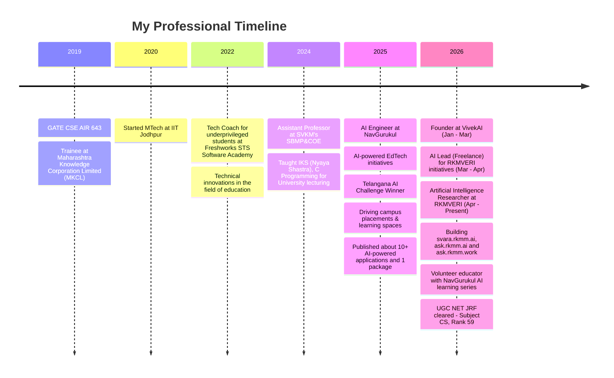

<div align="center">
  
# Hi there, I'm Vinit Gore! 👋

### 🤖 AI Researcher | 🎓 IIT Jodhpur Alumnus | 🌟 Social Impact Builder

*Building AI-powered solutions for heritage, education, and inclusive social impact*

---

[](https://www.linkedin.com/in/vinitgore/)
[](mailto:vinitgore1234@gmail.com)
[](https://huggingface.co/the-vedantic-coder)
[](https://rkmm.ai)

</div>

## 🚀 About Me

```python
class VinitGore:
    def __init__(self):
        self.role = "Artificial Intelligence Researcher @ RKMVERI"
        self.education = "MTech Computer Science - IIT Jodhpur"
        self.ugc_net_jrf = "Computer Science and Applications (99.87 percentile, Rank 59)"
        self.mission = "Applying AI for heritage preservation and social impact"
        self.org = "Ramakrishna Mission Vivekananda Educational and Research Institute"
    
    def skills(self):
        return {
            "languages": ["Python", "TypeScript", "JavaScript"],
            "frameworks": ["Next.js", "React", "Three.js"],
            "cloud": ["Azure", "AWS", "Zoho One Ecosystem"],
            "ai_ml": ["LLMs", "RAG", "Agentic AI", "Knowledge Graphs", "3DGS", "Workflow Automations"]
        }
```

## 🏆 Featured Achievements

### 🏛️ **AI for Heritage Preservation**
Leading AI adaptation at RKMVERI, including DST-funded heritage preservation projects like AI on 3D objects and research-driven social impact implementations.

### 📚 **Current Public & Private AI Portfolio**
- **svara.rkmm.ai** - Built and launched the official interactive harmonium songbook featuring bhajans from the Ramakrishna Order. [[Platform]](https://svara.rkmm.ai)
- **ask.rkmm.ai (Public)** - Led the development of a public LLM-powered publication Q&A platform for Ramakrishna-Vivekananda literature. [[Platform]](https://ask.rkmm.ai)
- **ask.rkmm.work (Private)** - Led the private deployment for monks with organization-specific access and workflows.
- **iLLaM** - Home to AI LLM-powered platform on Swami Vivekananda's life and teachings.
- **NavGurukul AI Learning Labs** - Developed 5+ AI learning solutions for 9 campuses, impacting 1200 students. [[Labs]](https://www.navgurukul.org/ailearninglabs)
- **Draw and Learn AI** - Represented NavGurukul and secured 1st place with ₹15 lakhs funding in Telangana AI Grand Challenge.

*🌐 Explore active work at [rkmm.ai](https://rkmm.ai)*

## 💼 Professional Journey



## 🛠️ Tech Stack

<div align="center">

### Programming Languages


### AI/ML & Frameworks


### DevOps & Tools


</div>


## 🎨 Beyond Code

When I'm not building AI solutions, you'll find me:

- ♟️ **Playing Chess/Board Games** - Strategic thinking on and off the board
- 📚 **Reading & Poetry** - Exploring literature and creative expression
- 🕺 **Dance** - Exploring different dance forms like Garba, etc.
- 🌍 **Cultural Exploration** - Discovering harmony in Indian languages, cultures and religions
- 🤝 **Volunteering** - Social and spiritual community activities
- 💭 **Philosophy** - Contemplating the intersection of technology and humanity

## 🤝 Let's Connect!

I'm always excited to collaborate on projects that create positive social impact, especially in:

- 🏛️ **AI for Heritage & Cultural Preservation**
- 🤖 **LLM, RAG, and Agentic AI Platforms**
- 🌐 **AI for Education in Underserved Communities**
- 🔬 **Research-led Applied AI Systems**

<div align="center">

### 🚀 Ready to make an impact together?

[](https://rkmm.ai)
[](https://www.linkedin.com/in/vinitgore/)
[](mailto:vinitgore1234@gmail.com)

---

*"Technology is best when it brings people together and creates opportunities for those who need them most."*


</div>
